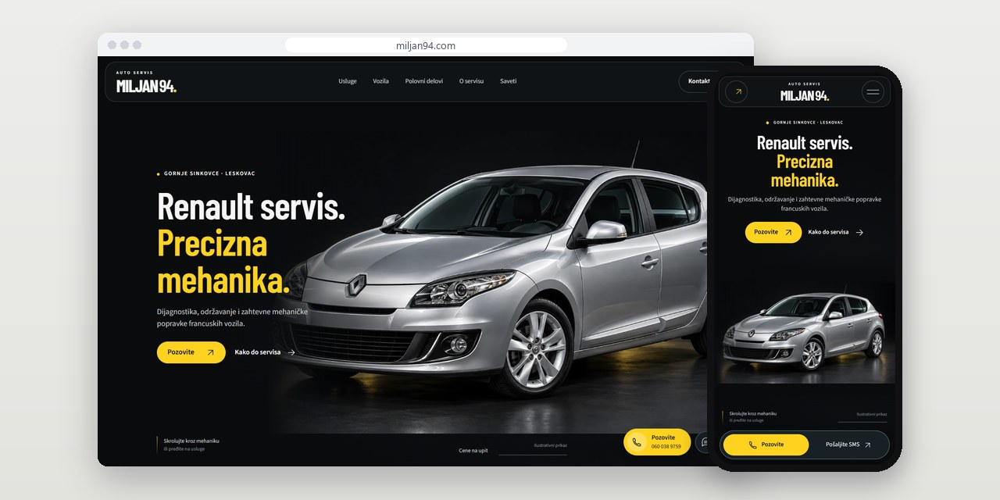
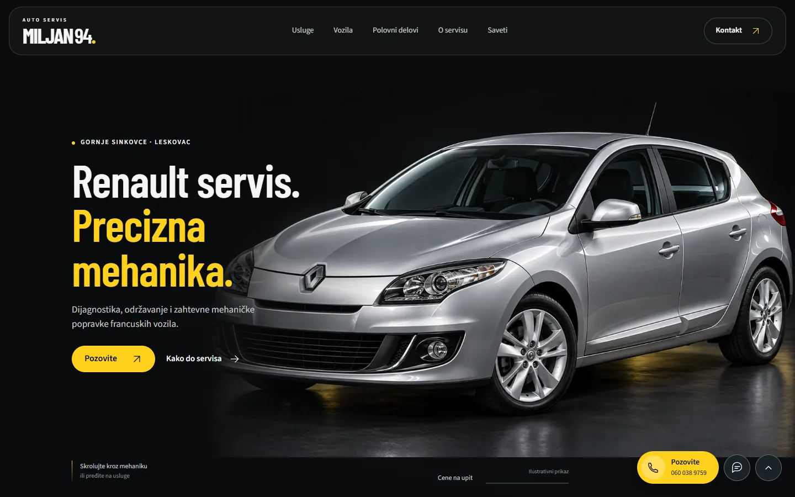
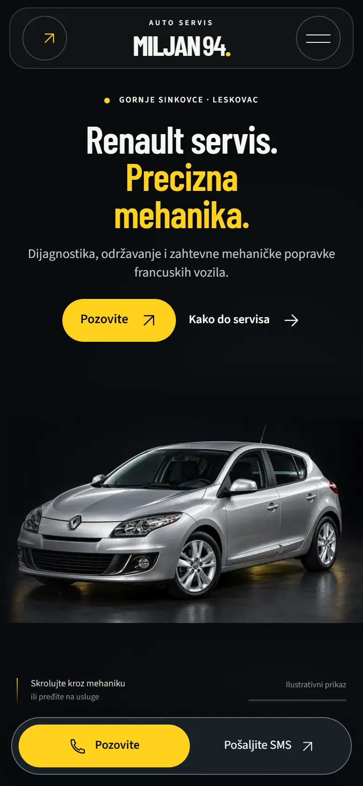
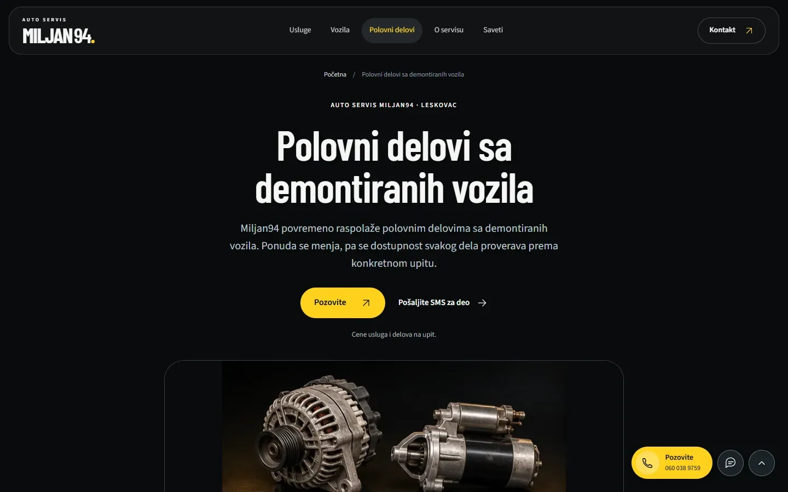
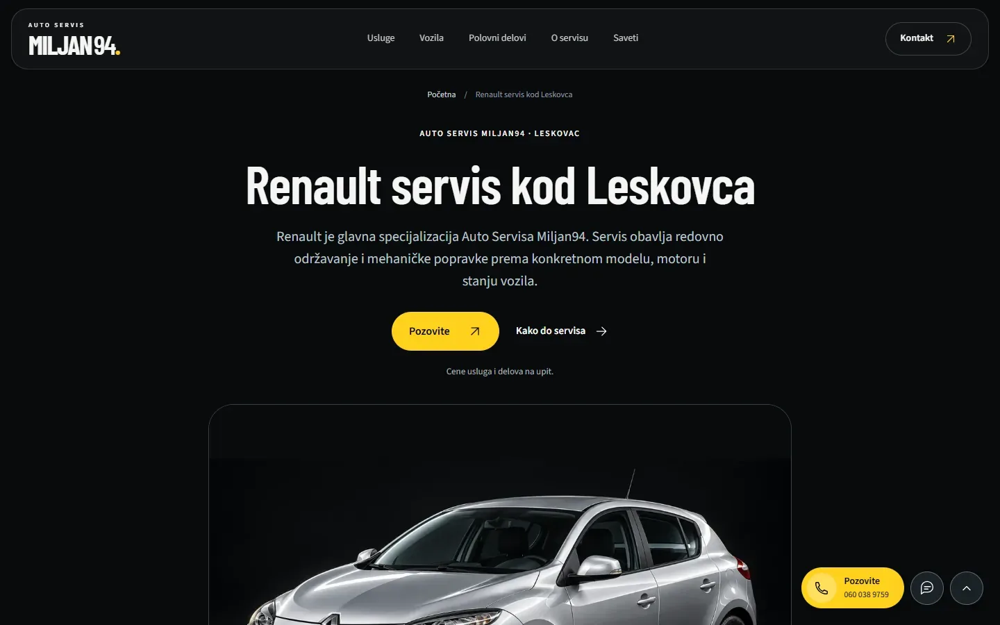

# Auto Servis Miljan94

Sajt od 24 strane za servis francuskih vozila kod Leskovca, sa automobilom koji se na naslovnoj rastavlja skrolom.

**[miljan94.com](https://miljan94.com/)** · [Studija slučaja](https://svilenkovic.rs/radovi/miljan94) · [English](README.md)

> [!NOTE]
> Klijentski projekat. Izvorni kod pripada klijentu i čuva se u privatnom repozitorijumu. Ova stranica opisuje šta sam uradio i kako.

<table>
  <tr><td><b>Klijent</b></td><td>Auto Servis Miljan94</td></tr>
  <tr><td><b>Delatnost</b></td><td>Servis Renault i drugih francuskih vozila i polovni delovi po upitu</td></tr>
  <tr><td><b>Lokacija</b></td><td>Leskovac</td></tr>
  <tr><td><b>Vrsta</b></td><td>Sajt sa više strana</td></tr>
  <tr><td><b>Moj deo posla</b></td><td>Dizajn, izrada, SEO i hosting</td></tr>
  <tr><td><b>Tehnologije</b></td><td>Astro 7, TypeScript, Canvas, nginx, JSON-LD</td></tr>
</table>

## O projektu

Auto Servis Miljan94 je servis u Gornjem Sinkovcu kod Leskovca. Radi najviše Renault vozila, ali i Peugeot, Citroën i Dacia, od dijagnostike i servisa do popravki motora, kvačila i menjača, a povremeno ima i polovne delove sa demontiranih vozila. Sve se dogovara telefonom, pa je sajt trebalo da jasno objasni posao i olakša poziv, bez obećanja o delovima na stanju i cenama unapred.

Naslovnu sam složio oko automobila koji se rastavlja dok se skroluje: odvajaju se hauba i točak, vide se motor, kvačilo i kočnica, a na kraju se automobil ponovo sklapa. Pokret prati običan skrol u oba smera, sa 144 kadra na računaru i 72 lakša na telefonu, a kada sistem traži manje pokreta ili je uključena ušteda podataka, ostaje mirna slika. Servis još nije imao fotografije svojih radova, pa su vozila i delovi ilustracije. Velika slika na vrhu svake strane nosi oznaku „Ilustrativni prikaz”, a strana o privatnosti kaže da nijedna ne prikazuje radionicu ni urađene poslove.

## Šta sam uradio

- 24 strane: po jedna za osam usluga i četiri marke vozila, uz savete za vozače, polovne delove, kontakt i privatnost
- Automobil koji se rastavlja skrolom, iscrtan na canvasu, sa kadrovima koji se učitavaju postepeno oko mesta do kog je posetilac stigao
- Strana o polovnim delovima bez kataloga, sa objašnjenjem šta treba poslati da bi se proverila dostupnost
- Dugmad za poziv i SMS na svakoj strani umesto obrasca, a na telefonu traka sa pozivom i SMS-om pri dnu
- Strukturisani podaci za servis i svaku uslugu, bez cena i ocena
- Provera svake strane, veze, slike i mape sajta pre svakog objavljivanja

## Merenja

| | Performanse | Pristupačnost | Dobre prakse | SEO |
| :-- | :-: | :-: | :-: | :-: |
| Telefon | 100 | 100 | 100 | 100 |
| Desktop | 100 | 100 | 100 | 100 |

PageSpeed Insights, laboratorijsko merenje živog sajta, novembar 2026. Sigurnosna zaglavlja: 6 od 6. Strukturisani podaci: `AutoRepair`, `Person`.

## Snimci ekrana

<table>
  <tr>
    <td width="68%" valign="top"></td>
    <td width="32%" valign="top"></td>
  </tr>
</table>

Polovni delovi: dostupnost svakog dela se proverava prema upitu, uz dugmad za poziv i SMS

Renault servis kod Leskovca: jedna od četiri strane po marki vozila

---

Izrada: [D. Svilenković](https://svilenkovic.rs).
